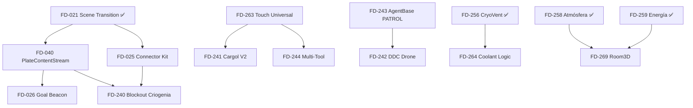

# ROADMAP.md — Odisea Acto I

**Generado:** 2026-11-13 | **Fuente:** FEATURE_INDEX.md + slice_convergence.md  
**Slice actual:** FD-320 RingHub + Bahía de máquinas (In Progress)

---

## 🎯 Objetivo Inmediato: Vertical Slice Jugable

> Una ruta corta y rejugable: **interior → airlock/tubo → plate centrífuga con plataformas → objetivo → transición a otra sala**  
> (ver *Product Direction 2026-05-29* en FEATURE_INDEX.md)

---

## P0 — Desbloquea Construir Niveles (Active Backlog)

| Orden | FD | Título | Estado | Esfuerzo | Dependencias | Entregable |
|-------|----|--------|--------|----------|--------------|------------|
| 1 | **FD-040** | PlateContentStream Authoring | In Progress | Small | FD-021 (Scene Transition) | Sub-escenas jugables por plate; authoring estable |
| 2 | **FD-026** | Goal Beacon | Planned | Small | FD-040 (plates authoring) | Loop de nivel testeable: beacon → complete → transition |
| 3 | **FD-025** | Tube / Airlock Connector Kit | Planned | Small | FD-021 (AirlockZoneV2) | Kit de conectores interior↔plate (prefabs + snapping) |
| 4 | **FD-020** | WallManager Area | In Progress | Medium | — | Cámara legible en interiores estrechos (anti-clipping) |

**Nota:** FD-021 (Scene Transition) y FD-042 (OTS Camera) ya están **Implemented** — base lista.

---

## P0 — Contenido Jugable Acto I (Post-FD-239)

| Orden | FD | Título | Estado | Esfuerzo | Bloqueadores / Notas |
|-------|----|--------|--------|----------|----------------------|
| 5 | **FD-240** | Blockout Módulo Criogenia | Planned | Medium | Requiere FD-025 (connectors) + FD-040 (plates) |
| 6 | **FD-241** | Cargol V2 — Compañero Funcional | Design | Medium | Requiere FD-263 (touch universal) |
| 7 | **FD-242** | DDC Drone + Sigilo Básico | Design | Medium | Requiere AgentBase PATROL fix (FD-243) |
| 8 | **FD-244** | Multi-Tool — Láser + Gloo Gun | Design | Medium | Requiere FD-263 (interaction) |
| 9 | **FD-263** | Touch Universal (tap + runtime detection) | Design | Medium | Base para Cargol, Multi-Tool, interactuables |
| 10 | **FD-264** | Lógica circuitos coolant (OCLS flow graph) | Design | Medium | Puzzle principal criogenia; usa FD-256 (CryoVent) |
| 11 | **FD-269** | Room3D — estado ambiental por habitación | Design | Medium | Temp/presión/contaminación; integra FD-258/259 |

---

## P1 — Mejora Inmersión y Continuidad

| FD | Título | Estado | Esfuerzo | Comentario |
|----|--------|--------|----------|------------|
| FD-032 | Seamless Startup Streaming | In Progress | Large | Vecinos de transición → chunks; base para streaming real |
| FD-033 | Advanced Traversal | In Progress | Large | Ladder/ledge core **solo si el nivel lo necesita** |
| FD-034 | Player Interaction Hints | Planned | Medium | Teachability: portales, objetivos, props |
| FD-041 | Faux Skydome / Parallax Shell | Design | Medium | Fondo barato casco/espiral (GLES2/3) |
| FD-038 | ZeroGravityController | In Progress | Medium | Prototipo jugable; decidir si entra Acto I |
| FD-280 | Linterna casco (Spotlight + máscara) | Implemented | Small | ✅ Done |
| FD-296 | OdiseaOS — HUD + widgets + HUDables | In Progress | Large | En curso (parallel session: src-1) |
| FD-294 | Control Remoto (UDP discovery + WS) | In Progress | Large | Sesiones ODISEA multi-device |
| FD-313 | Ergonomía HUD / determinismo Control Remoto | Planned | Medium | Parity fixes |
| FD-314 | Streaming scaffold RingHub (MultiMesh + chunks) | Planned | Large | Performance en RingHub |
| FD-316 | Sim Host Remoto (render-esclavo low-end) | Planned | Large | Físicas 60Hz en host |

---

## P2 — Ambiente, Escala y Prototipos

| FD | Título | Estado | Esfuerzo |
|----|--------|--------|----------|
| FD-250 | Dome_Intro bake reproducible + iluminación híbrida | In Progress | Large |
| FD-037 | Infinite Scaffold Field | Design | Large |
| FD-035 | ConveyorCarrousel | Design | Medium |
| FD-022 | BGM Audio Manager | Planned | Medium |
| FD-027 | Spawn Cinematic / ScreenBorders | In Progress | Medium |
| FD-261 | Editor de circuitos usable (Dome_Intro) | Design | Small |
| FD-262 | Generador procedural de rutas tuberías | Design | Medium |

---

## P3 — Contenido Posterior (Backlog)

| FD | Título | Estado | Nota |
|----|--------|--------|------|
| FD-019 | Multiplayer Split-screen | In Progress | Congelado |
| FD-029 | DDC Drone | Planned | NPC posterior |
| FD-030 | Cargol NPC | Planned | NPC posterior |
| FD-031 | Narrative Dialogs (IA) | Planned | Postergar hasta que el loop jugable pida diálogos |

---

## 🔗 Dependencias Críticas (Grafo)

---

## 📦 Entregables por Hito

| Hito | FDs | Criterio de Aceptación |
|------|-----|------------------------|
| **M1: Vertical Slice Core** | FD-040, FD-026, FD-025, FD-020 | Ruta interior→plate→goal→transition jugable sin cortes |
| **M2: Criogenia Blockout** | FD-240, FD-263, FD-264 | Módulo criogenia con 2-3 puzzles de coolant funcionales |
| **M3: NPCs Básicos** | FD-241, FD-242, FD-243 | Cargol usable + DDC patrulla + sigilo básico |
| **M4: Herramientas Jugador** | FD-244, FD-269 | Multi-Tool (laser/gloo) + Room3D ambiental |
| **M5: Polish Acto I** | FD-032, FD-034, FD-041, FD-250 | Streaming, hints, skydome, Dome_Intro bake final |

---

## ⚠️ Riesgos y Decisiones Pendientes

| Tema | Riesgo | Decisión Necesaria |
|------|--------|-------------------|
| **Zero-G (FD-038)** | Prototipo existe; ¿divierte o distrae? | Playtest en slice M1 → keep/cut |
| **Sim Host (FD-316)** | Arquitectura grande; ¿necesario para Acto I? | Evaluar target handheld (Anbernic/RG351V) |
| **MultiMesh Scaffold (FD-314)** | Performance RingHub; ¿bloquea M1? | Profile actual → decidir prioridad |
| **i18n Coreano (FD-309)** | ✅ Resuelto (DungGeunMo fallback) | Nada pendiente |
| **CI flake determinism** | test_push_clipping bimodal | Entendido: sensibilidad solver Box3D, no HW |

---

## 📋 Próximas Acciones (Esta Semana)

1. **FD-040** — Completar PlateContentStream authoring (sub-escenas por plate)
2. **FD-020** — Terminar WallManager (anti-clipping cámara interiores)
3. **FD-025** — Diseñar Connector Kit (prefabs airlock↔tube↔plate)
4. **FD-026** — Implementar Goal Beacon (loop testeable)
5. **CI Review** — Consolidar 7 workflows (ver análisis separado)

---

## 📚 Referencias

- `docs/features/FEATURE_INDEX.md` — índice canónico de estado
- `docs/agents/sessions/2026-11-13_slice_convergence.md` — estado slice FD-320
- `docs/engineering/Gravity_Physics_Contracts.md` — contratos gravedad/física
- `docs/features/FD-040_plate_content_stream_stability.md` — estabilidad streaming
- `docs/features/FD-036_gravity_manager.md` + `FD-039_gravity_physics_strategy.md`